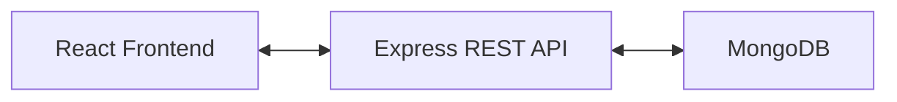
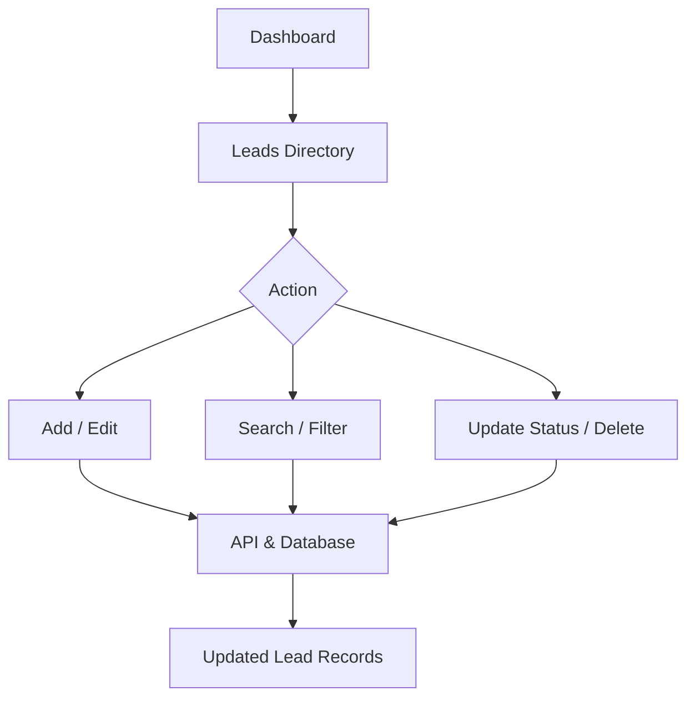

# 🚀 LeadFlow — Lead Management CRM

<p align="center">
  A Full-Stack Lead Management Application
  <br />
  <strong>Meru Technosoft Pvt. Ltd. — Full Stack Developer Screening Assignment</strong>
</p>

<p align="center">
  
  
  
  
  
</p>

---

## 📌 Overview

**LeadFlow** is a full-stack CRM application designed to simplify lead management and help teams organize prospective clients, track lead progress, and monitor sales pipeline performance.

The application provides a responsive dashboard and a complete lead management workflow using React, Node.js, Express, and MongoDB.

## ✨ Features

- 👤 **Lead Management** — Create, view, edit, and delete leads.
- 📊 **Dashboard** — View total leads and status-wise statistics.
- 🔄 **Status Tracking** — Manage leads through New, Contacted, Qualified, and Lost stages.
- 🔍 **Search** — Search leads by name, email, or company.
- 🎯 **Filtering** — Filter leads by status and source.
- ↕️ **Sorting** — Organize lead records using sorting options.
- 📄 **Pagination** — Navigate through lead records efficiently.
- ✅ **Form Validation** — Validate inputs on both frontend and backend.
- 🛡️ **Duplicate Prevention** — Prevent duplicate email addresses.
- 📱 **Responsive UI** — Interface optimized for desktop and mobile.
- ❤️ **API Health Check** — Monitor backend availability.

## 🛠️ Tech Stack

| Category | Technologies |
|---|---|
| Frontend | React 18, JavaScript, Vite, CSS |
| Backend | Node.js, Express.js |
| Database | MongoDB, Mongoose |
| Validation | Zod |
| API | REST API |
| Testing | Vitest, Supertest, MongoDB Memory Server |
| UI Icons | Lucide React |

## 🏗️ System Architecture

LeadFlow follows a client-server architecture. The React frontend communicates with the Express backend through REST APIs, while MongoDB handles persistent data storage.



**Flow:** User → React UI → REST API → Validation → Controllers → MongoDB.

## 🔄 Core Workflow



## 📁 Project Structure

```text
lead-manager/
│
├── client/
│   └── src/
│       ├── components/
│       │   ├── Dashboard/
│       │   ├── Leads/
│       │   ├── Layout/
│       │   └── UI/
│       ├── hooks/
│       ├── services/
│       ├── utils/
│       ├── App.jsx
│       └── main.jsx
│
├── server/
│   ├── src/
│   │   ├── config/
│   │   ├── controllers/
│   │   ├── middleware/
│   │   ├── models/
│   │   ├── routes/
│   │   ├── validators/
│   │   ├── app.js
│   │   └── server.js
│   │
│   └── test/
│
├── package.json
└── README.md
```

## ⚙️ Getting Started

### Prerequisites

- Node.js 18 or later
- npm
- MongoDB local installation or MongoDB Atlas

### 1️⃣ Clone the Repository

```bash
git clone https://github.com/madupojumounika/lead-manager.git
cd lead-manager
```

### 2️⃣ Install Dependencies

```bash
npm install
```

### 3️⃣ Configure Environment Variables

Create the backend environment file:

```bash
cp server/.env.example server/.env
```

Configure `server/.env`:

```env
PORT=5000
NODE_ENV=development
MONGODB_URI=mongodb://127.0.0.1:27017/lead_manager
CLIENT_URL=http://localhost:5173
```

Update the MongoDB connection string according to your environment.

🔐 **Security:** Never commit actual `.env` files, database passwords, API keys, or secret credentials. Keep only safe example configuration files in the public repository.

### 4️⃣ Run the Application

```bash
npm run dev
```

The frontend and backend start together.

| Service | URL |
|---|---|
| Frontend | http://localhost:5173 |
| Backend Health | http://localhost:5000/api/health |

To run services separately:

```bash
npm run dev:server
npm run dev:client
```

## 🔌 REST API Endpoints

All endpoints are prefixed with `/api`.

| Method | Endpoint | Description |
|---|---|---|
| GET | `/api/health` | Check API health |
| GET | `/api/leads` | Retrieve all leads |
| GET | `/api/leads/:id` | Retrieve a specific lead |
| POST | `/api/leads` | Create a new lead |
| PUT | `/api/leads/:id` | Update lead information |
| PATCH | `/api/leads/:id/status` | Update lead status |
| DELETE | `/api/leads/:id` | Delete a lead |
| GET | `/api/dashboard/stats` | Retrieve dashboard statistics |

The lead listing endpoint supports search, filtering, sorting, and pagination.

## 🧪 Testing

Run the backend automated test suite:

```bash
npm test
```

### ✅ Verified Results

| Verification | Result |
|---|---|
| Backend automated tests | 21/21 Passed |
| Frontend production build | Passed |
| API health check | Passed |
| Frontend-backend integration | Verified |
| Lead CRUD operations | Manually Tested |

Build the frontend for production:

```bash
npm run build
```

Production assets are generated in `client/dist/`.

## 🗄️ Database Note

During local development, if a MongoDB connection is unavailable, the backend can automatically use an in-memory MongoDB instance as a fallback. This database is temporary, and all records are lost when the server stops.

For persistent data storage and production deployment, configure MongoDB Atlas or another persistent MongoDB database.

## 🚀 Future Improvements

- 🔐 User authentication and role-based access.
- 📝 Lead activity history and follow-up reminders.
- 📥 CSV import and export.
- 📈 Advanced analytics and reporting.

## 👩‍💻 Author

**Mounika Madupoju**

Full Stack Developer Screening Assignment  
**Meru Technosoft Pvt. Ltd.**

🔗 [GitHub Profile](https://github.com/madupojumounika)  
📂 [Project Repository](https://github.com/madupojumounika/lead-manager)

---

<p align="center">
  Built with ❤️ using React, Node.js, Express, and MongoDB.
</p>